# Actividad 4: API REST con Spring Boot, Spring Security y JWT

## 1. Descripción

Esta actividad consiste en desarrollar una API REST para gestionar empleados y departamentos utilizando Spring Boot, Spring Data JPA y MySQL.

La aplicación implementa autenticación mediante Spring Security y tokens JWT, validación de datos con DTOs y operaciones CRUD protegidas.

A diferencia de la Actividad 3, este proyecto utiliza exclusivamente respuestas JSON, sin vistas Thymeleaf.

## 2. Tecnologías utilizadas

- Java 21
- Spring Boot 4.1.2
- Spring Web
- Spring Data JPA y Hibernate
- Spring Security
- JWT
- Bean Validation
- MySQL 8
- Maven
- Bruno
- Ubuntu y VPS Contabo

## 3. Base de datos

**Base de datos:** `bd_empleados_act4`

Se utilizan tres entidades:

- Usuario: almacena los datos necesarios para la autenticación y la contraseña protegida mediante hash.
- Departamento: almacena los departamentos de la empresa.
- Empleado: almacena los empleados y su relación con un departamento.

La relación entre departamentos y empleados es de uno a muchos. Un departamento puede tener varios empleados y cada empleado pertenece a un departamento.

## 4. Arquitectura

El proyecto está organizado en capas:

- `models`: entidades JPA relacionadas con las tablas de MySQL.
- `repository`: operaciones de acceso a datos mediante JpaRepository.
- `services`: lógica de negocio y conversión entre entidades y DTOs.
- `controllers`: recepción de peticiones HTTP y respuestas JSON.
- `dto`: estructuras para recibir, validar y devolver datos.
- `security`: configuración de Spring Security, generación y validación de JWT.
- `GlobalExceptionHandler`: manejo de errores de validación.

## 5. Endpoints

| Método | Endpoint | Función |
|---|---|---|
| POST | `/api/auth/register` | Registrar usuario |
| POST | `/api/auth/login` | Autenticar y generar JWT |
| GET | `/api/empleados?page=0&size=10` | Consultar empleados paginados |
| GET | `/api/empleados/{id}` | Consultar empleado por ID |
| POST | `/api/empleados` | Crear empleado |
| PUT | `/api/empleados/{id}` | Actualizar empleado |
| DELETE | `/api/empleados/{id}` | Eliminar empleado |
| GET | `/api/departamentos` | Listar departamentos |
| GET | `/api/departamentos/{id}` | Consultar departamento |
| POST | `/api/departamentos` | Crear departamento |

Los endpoints del CRUD necesitan un token JWT válido.

## 6. Autenticación y seguridad

El registro y el inicio de sesión son públicos mediante `/api/auth/**`.

Cuando un usuario inicia sesión correctamente, la aplicación genera un JWT firmado. Las peticiones a los endpoints protegidos deben incluir el encabezado:

`Authorization: Bearer <token>`

Spring Security verifica el token y permite o rechaza el acceso según corresponda.

Las contraseñas se almacenan mediante hash y no se devuelven en las respuestas.

## 7. Evidencias de Bruno

### Acceso sin JWT — 401 Unauthorized

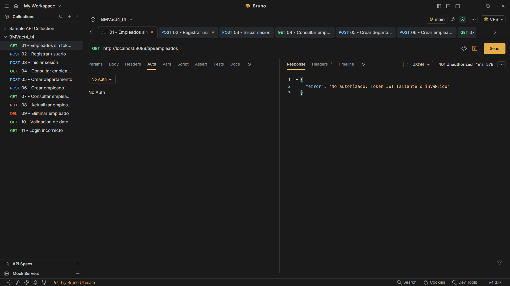

### Registro de usuario — 201 Created

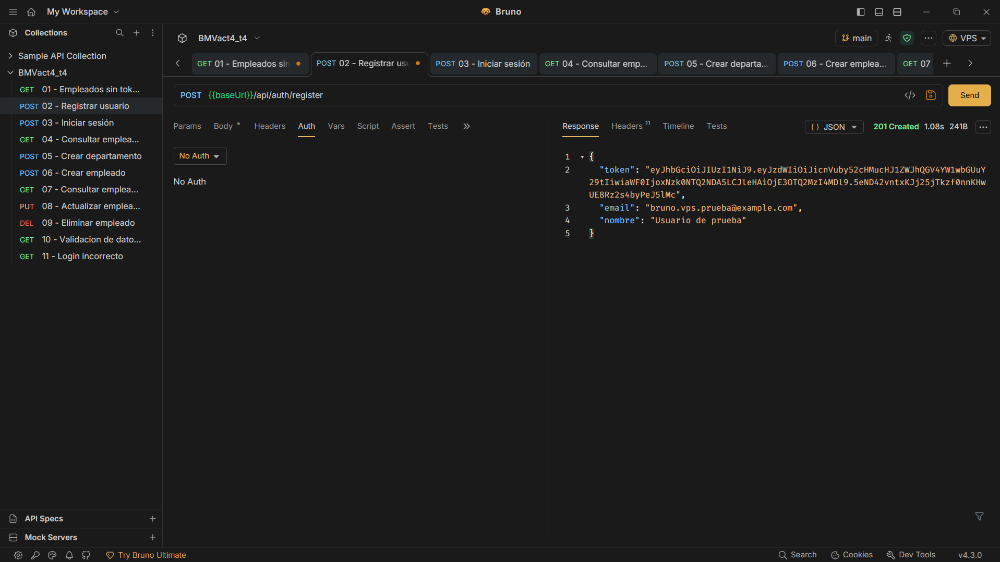

### Login con JWT — 200 OK

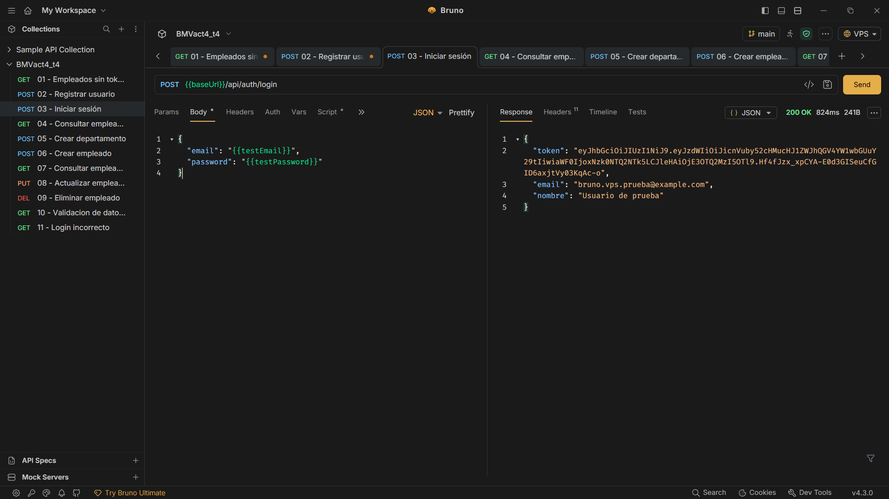

### Consulta paginada — 200 OK

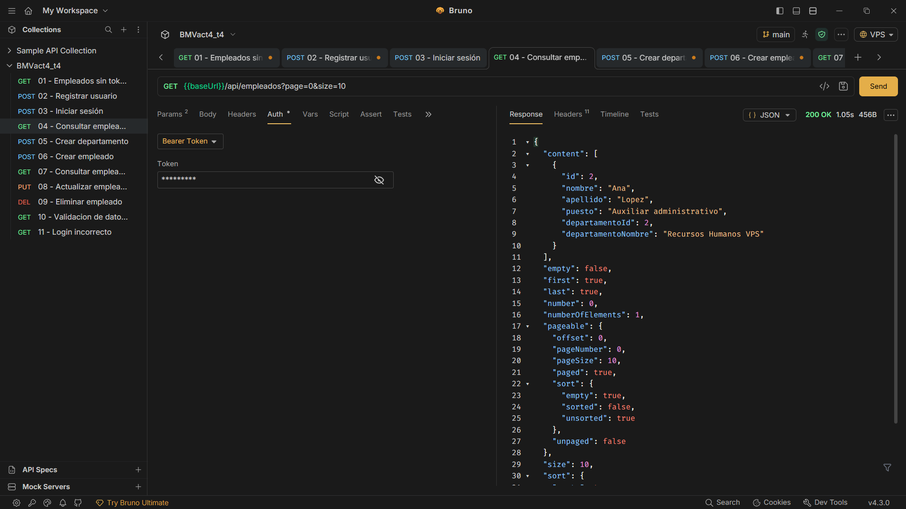

### Creación de departamento — 201 Created

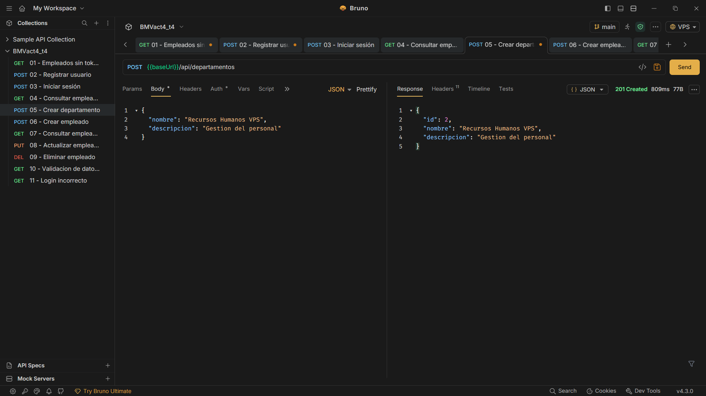

### Creación de empleado — 201 Created


### Consulta de empleado por ID — 200 OK

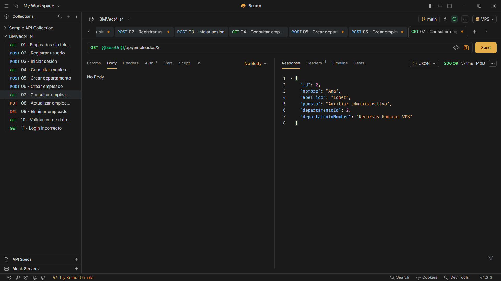

### Actualización de empleado — 200 OK

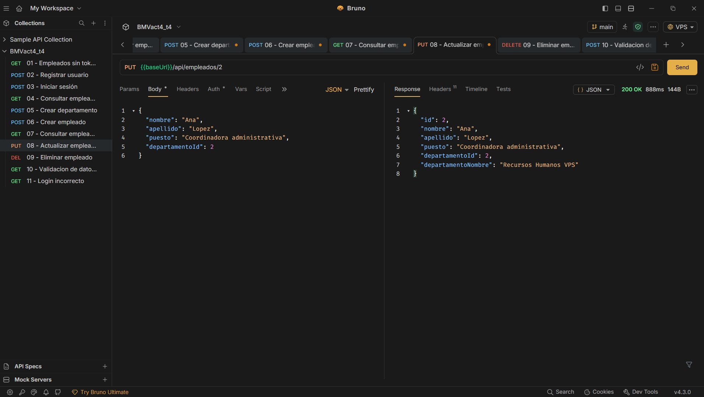

### Eliminación de empleado — 200 OK

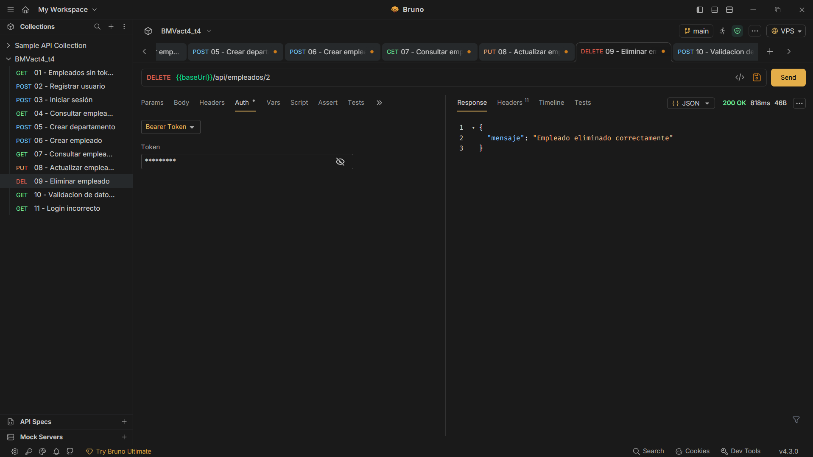

### Consulta de empleado eliminado — 404 Not Found

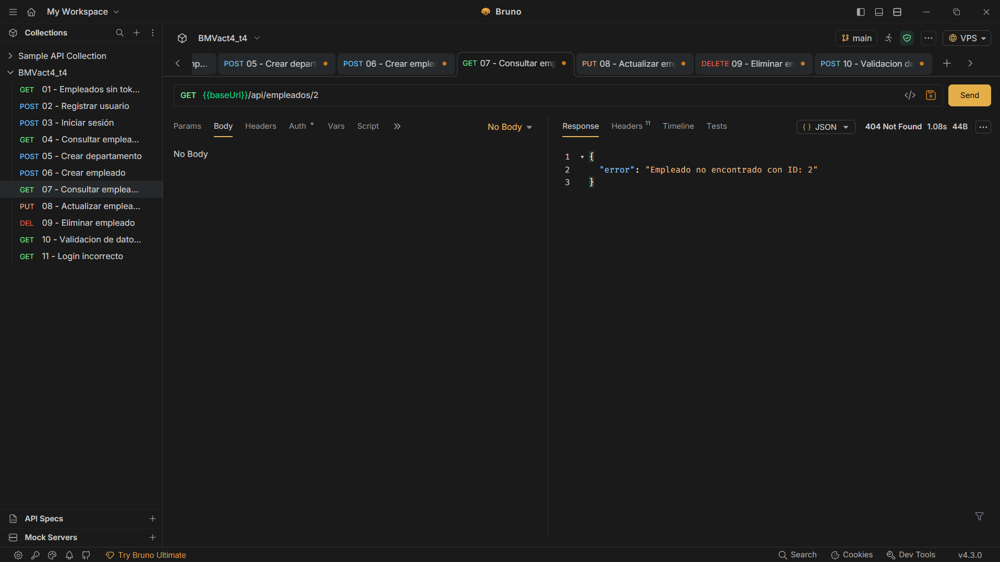

### Validación de datos incorrectos — 400 Bad Request

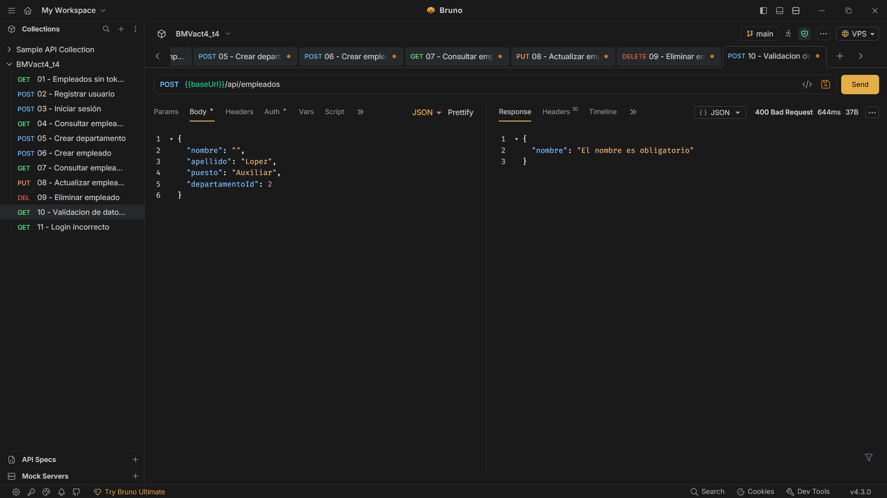

### Inicio de sesión incorrecto — 401 Unauthorized

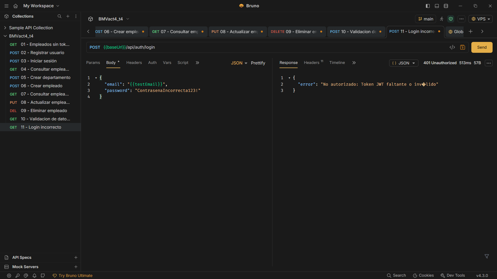

## 8. Colección de Bruno

La carpeta `bruno` contiene las peticiones utilizadas para probar la API.

Incluye solicitudes de registro, login, consultas, creación, actualización, eliminación y pruebas de seguridad.

La colección utiliza variables como `baseUrl`, `testEmail` y `testPassword`. Las contraseñas y los tokens deben configurarse localmente y no incluirse en el repositorio.

## 9. Ejecución y despliegue

La aplicación utiliza el puerto **8088**.

**Servidor VPS:** Contabo con Ubuntu.

**Dirección base:** http://13.140.209.186:8088

**Base de datos:** MySQL en el propio VPS, puerto 3306.

Las credenciales de MySQL y la clave JWT se proporcionan mediante variables de entorno:

- `DB_USER`
- `DB_PASSWORD`
- `DB_PORT`
- `JWT_SECRET`

El proyecto se compila mediante Maven:

```powershell
.\mvnw.cmd package -DskipTests
```

En el VPS, el JAR se almacena en `/opt/springboot-8088/`.

El servicio `springboot-act4` permite mantener ejecutándose la aplicación de forma independiente.

Para probar endpoints autenticados desde una computadora local sin exponer credenciales por HTTP público se utiliza un túnel SSH hacia el puerto 8088 del VPS.

## 10. Resultados

Se comprobó el funcionamiento de:

- Registro e inicio de sesión con JWT.
- Protección de endpoints privados.
- Operaciones CRUD completas.
- Paginación de resultados.
- Relación entre empleados y departamentos.
- Validación de datos mediante DTOs.
- Respuestas HTTP adecuadas.
- Persistencia en MySQL.

La aplicación permite gestionar empleados de forma segura mediante una API REST, reutilizando los conocimientos de las actividades anteriores.